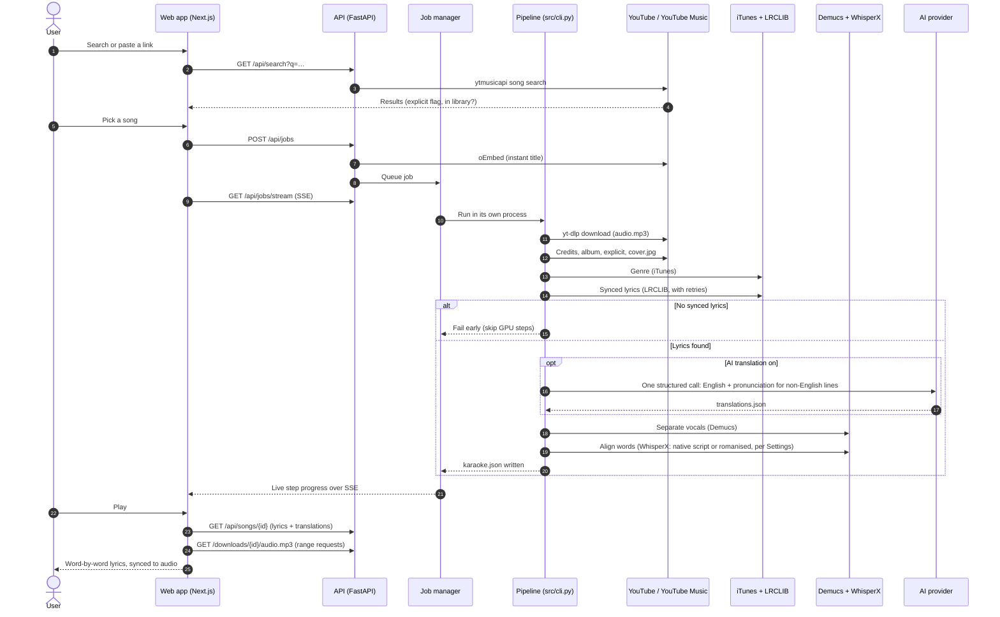

# 🎤 SingAlongSync

Get **word-by-word, Apple Music Sing-style synced lyrics for any song on YouTube Music**, using open-source WhisperX and synced lyrics from LRCLIB.

Give it a YouTube Music link (or search for a song) and it downloads the audio, isolates the vocals, fetches synced lyrics, times every word to the millisecond, and optionally translates non-English lines into English. Use it from the terminal, or through the included Apple Music-style web app with a library, a full-screen karaoke player and in-app downloads.

> [!TIP]
> **How to obtain word-by-word Apple Music Sing-Along-like lyrics?**
> This repository is a direct answer to that search. By combining **Demucs** vocal separation with **WhisperX phonetic alignment** and synced lyrics from the **LRCLIB API**, it computes exact millisecond-level word timings. Use the resulting `karaoke.json` to power real-time color-sweeping lyrics in web apps, video editors, or custom karaoke engines.

---

## ✨ Features

### Pipeline
- **High-Quality Audio Downloading:** `yt-dlp` + `ffmpeg` extract the best audio track as a 320kbps MP3.
- **Synced Lyrics Extraction:** Queries [LRCLIB](https://lrclib.net/) for time-synced lyrics (`.lrc`), matched by title, artist and duration. Songs without synced lyrics stop early instead of wasting GPU time.
- **AI-Powered Vocal Separation:** The **Demucs** (`htdemucs`) model splits audio into vocal and instrumental stems.
- **Word-Level Alignment:** **WhisperX** forced alignment times every word. The alignment model is picked from the lyrics' script, so Hindi, Telugu, Malayalam and English songs each use a matching model.
- **Rich Metadata:** **YouTube Music** (via `ytmusicapi`) supplies credited artists, album, year, explicit flag, a square album cover and artist avatars. Genres come from the **iTunes Search API**.
- **AI Translation (optional):** One structured-output call per song returns English for every non-English line, including romanised lyrics (Hindi written in English letters) and songs that mix languages line by line. Works with OpenAI, Google, Anthropic, Groq, xAI or OpenRouter using your own API key.
- **Intelligent Caching:** Every step is skipped when its output already exists, so retries resume where they stopped.
- **Rich TUI:** Gradient panels, spinners, live progress, lyric previews and an output summary table in the terminal.

### Web app
- **Library** with **Songs, Albums, Artists and Genres** sections, detail pages for each album, artist and genre, and one search box that filters whichever page you're on.
- **Full-screen player** with word-by-word lyric fill, a cascading scroll, instrumental-break dots, click-to-seek lines, manual lyric browsing, and a slowly turning backdrop built from the cover art.
- **Karaoke mode** plays the instrumental stem instead of the full mix, with an optional guide-vocals slider.
- **English translations** and **pronunciation** (non-Latin-script lines in English letters) under each line, toggled from the player.
- **Lyrics timing nudge** per song, for when lines feel early or late; saved on the server.
- **Up next** queue view, a **Recently played** row, a persistent mini player, queue-aware next/previous (album, artist or whole library), keyboard shortcuts and OS media keys.
- **Add songs** by searching YouTube Music or pasting a link, then watch each step live in the same dialog. Jobs keep running in the background, tracked from the navbar's downloads menu.
- **Settings** for the AI translation provider, API key and model, plus translating songs already in your library.
- **Delete songs** (and their files) from the library.

---

## 📺 Demonstration Videos

Watch the demonstration videos below to see **SingAlongSync**'s CLI processing and Web UI player in action. (Recorded with an earlier version of the web UI.)

### 🌐 1. Web UI Apple Music Karaoke Player
Shows the song library, color-extracted backdrops, and fluid word-by-word sweeping highlights:

<video src="https://github.com/user-attachments/assets/1bc74b87-c34e-4b5f-b07e-c3dec88071e0" controls width="100%"></video>

_Direct link: [Watch Web UI Demo directly in your browser](https://github.com/user-attachments/assets/1bc74b87-c34e-4b5f-b07e-c3dec88071e0)_

### 💻 2. CLI / TUI Processing Stage
Shows how you process songs in the terminal using the rich TUI:

<video src="https://github.com/user-attachments/assets/317f310f-c52e-434c-95ad-9657a1131856" controls width="100%"></video>

_Direct link: [Watch TUI Demo directly in your browser](https://github.com/user-attachments/assets/317f310f-c52e-434c-95ad-9657a1131856)_

---

## ⚙️ How It Works (Sequence Diagram)



The CLI runs the same pipeline (steps 11–19) directly in your terminal.

---

## 🛠️ The Pipeline Workflow

1. **Download:** Fetches `audio.mp3` and writes `metadata.json`. Metadata is then enriched from YouTube Music (artists, album, year, explicit flag, `cover.jpg`) and iTunes (genre).
2. **Fetch Lyrics:** Downloads the synced `.lrc` from LRCLIB and previews the first lines. If no synced lyrics exist, the run stops here.
3. **Translate** *(only when AI translation is on)*: Writes English and Latin-letter pronunciation for non-English lines to `translations.json`, before the GPU steps. A failed translation never fails the song.
4. **Separate Vocals:** Demucs splits the audio into `vocals.wav` and `instrumental.wav`, then FFmpeg encodes MP3 copies for karaoke mode.
5. **Align Lyrics:** Detects the lyrics' script and aligns every word with WhisperX, writing `karaoke.json` (one entry per lyric line). Per **Settings > Lyrics alignment**: *Native script* aligns the lyrics as written with the script's own model; *Romanised* converts non-Latin lines to English letters (from the AI translation, or built-in transliteration) and aligns them with the English model; *Auto* (default) uses the native model for Hindi, Telugu and Malayalam and romanises scripts that have no model of their own (Punjabi, Tamil, Kannada, Bengali, Gujarati, Odia). The player always shows the original words.

---

## 🏗️ Project Structure

```
SingAlongSync/
├── server/                 # Python backend (uv project)
│   ├── app.py              # Entry point: starts the API on 127.0.0.1:8000
│   ├── src/
│   │   ├── cli.py          # CLI entry point
│   │   ├── pipeline.py     # KaraokePipeline: the five steps above
│   │   ├── api.py          # FastAPI routes
│   │   ├── jobs.py         # Background download jobs (one at a time, live progress)
│   │   ├── youtube.py      # yt-dlp download, oEmbed quick metadata
│   │   ├── ytmusic.py      # YouTube Music search, credits, covers, artist avatars
│   │   ├── enrich.py       # Metadata enrichment + background backfill
│   │   ├── lyrics.py       # LRCLIB search and LRC parsing
│   │   ├── lang.py         # Script detection and WhisperX align codes
│   │   ├── translate.py    # AI translation (pydantic-ai) and provider model lists
│   │   ├── translation_queue.py
│   │   ├── settings.py     # AI provider settings (server/settings.json)
│   │   └── library.py, status.py, config.py
│   └── downloads/          # One folder per processed song
└── web/                    # Next.js + Tailwind web app (bun)
    ├── app/                # Routes: /, /albums, /artists, /genres, their detail pages, /settings
    ├── components/         # library/, player/, settings/, shell/, ui/
    └── lib/                # API client, player engine, stores
```

---

## 📂 Output File Structure

Every processed song gets its own folder at `server/downloads/<video_id>/`:

```
downloads/<video_id>/
├── audio.mp3          # High-quality 320kbps track
├── audio.webp         # YouTube video thumbnail (16:9)
├── cover.jpg          # Square album cover from YouTube Music (preferred artwork)
├── metadata.json      # Title, artists, album, genre, year, explicit flag…
├── synced.lrc         # Line-synced lyrics from LRCLIB
├── vocals.wav         # Demucs vocal stem
├── instrumental.wav   # Demucs instrumental stem
├── vocals.mp3         # Compressed stems streamed by karaoke mode
├── instrumental.mp3
├── karaoke.json       # Word-level timings
├── translations.json  # English for non-English lines (only with AI translation)
├── status.json        # Pipeline stage and progress
└── job.log            # Full output of jobs started from the web app
```

### 📄 File Schemas

#### `karaoke.json` (word-level timings)
An array of lines, each with its words and their start/end times in seconds (3 decimal places):

```json
[
  {
    "line": "La da, la da da, la la la",
    "start": 3.721,
    "end": 7.119,
    "words": [
      { "word": "La", "start": 3.721, "end": 3.983 },
      { "word": "da,", "start": 4.204, "end": 4.626 },
      { "word": "la", "start": 4.666, "end": 4.908 }
    ]
  }
]
```

#### `metadata.json` (track info)
From `yt-dlp`, enriched with YouTube Music and iTunes. `genre`, `year` and `explicit` are `null` when unknown.

```json
{
  "videoId": "W2a8Ng1qM8Q",
  "title": "Your Love",
  "artist": "The Outfield",
  "artists": ["The Outfield"],
  "artistIds": { "The Outfield": "UC5TJtEuZGgv1Ci7cGF8gfCw" },
  "album": "Play Deep",
  "albumId": "MPREb_xwBJwx1f3xG",
  "year": "1985",
  "explicit": false,
  "genre": "Rock",
  "duration": 216,
  "thumbnail": "https://i.ytimg.com/vi_webp/W2a8Ng1qM8Q/maxresdefault.webp",
  "enriched": 2
}
```

#### `translations.json` (AI translation)
English keyed by the line's index in `karaoke.json`. Lines already in English are left out, so an empty `lines` object means the song is entirely English.

```json
{
  "provider": "openai",
  "model": "gpt-…",
  "createdAt": 1791812669.2,
  "version": 2,
  "lines": {
    "0": "I would give my life for you, I would give my life",
    "3": "O beloved, O my beloved"
  },
  "romanized": {
    "0": "Main vaari jaavan, main vaari jaavan"
  }
}
```

#### `synced.lrc` (line-synced lyrics)

```text
[00:03.72] La da, la da da, la la la
[00:07.11] La da, la da di da da, la la la la la
```

#### `status.json` (pipeline progress)

```json
{
  "stage": "complete",
  "downloaded": true,
  "lyrics_found": true,
  "separated": true,
  "detected_script": "English",
  "align_language_code": "en",
  "aligned": true
}
```

---

## 🚀 Installation & Usage

### Prerequisites

- Python ≥ 3.11 and [uv](https://docs.astral.sh/uv/)
- [FFmpeg](https://ffmpeg.org/) (used by `yt-dlp` and Demucs)
- A JavaScript runtime: **Node.js, Deno or Bun**. YouTube downloads need one to solve YouTube's JS challenge; without it downloads fail with HTTP 403.
- [Bun](https://bun.sh/) for the web app
- An NVIDIA GPU is strongly recommended (Demucs and WhisperX fall back to CPU, slowly). PyTorch is installed from the **CUDA 12.6** wheel index.

### Setup

```bash
cd server
uv sync
```

Optional `server/.env`:

```bash
HF_TOKEN=...                       # Hugging Face token, avoids rate limits when downloading alignment models
WEB_ORIGINS=http://localhost:3000  # Origins allowed to call the API (comma-separated)
HF_HUB_DISABLE_SYMLINKS_WARNING=1  # Silences a harmless Windows warning
```

### Using the CLI

From `server/`, run interactively:

```bash
uv run src/cli.py
```

Or pass a YouTube / YouTube Music URL:

```bash
uv run src/cli.py "https://music.youtube.com/watch?v=eZCWyFNV_ZM"
```

### Using the Web App

Start the backend API (songs, audio, search, download jobs) on `http://127.0.0.1:8000`:

```bash
cd server
uv run app.py
```

In a second terminal, start the web app:

```bash
cd web
bun install
bun run dev
```

Open 👉 **`http://localhost:3000`**

- **Add a song:** Click **Add song**, then search YouTube Music or paste a link. Pasting a link into the library search works too.
- **Browse:** Switch between Songs, Albums, Artists and Genres. The search box filters the current page; press `/` to focus it.
- **Play:** Click a song to open the full-screen player. `Space` plays/pauses, `←`/`→` seek 5 seconds, `M` mutes, `K` toggles karaoke mode, `[`/`]` shift the lyrics 0.1 s later/earlier, `Esc` closes the player.
- **Player header:** the microphone opens karaoke mode and the guide-vocals slider; the language button holds translation, pronunciation and lyrics timing; the list button shows what plays next.

If YouTube answers **"Sign in to confirm you're not a bot"** (it happens after many downloads from one IP), open **Settings > YouTube access** and pick a browser you're signed in to YouTube with (Firefox is most reliable on Windows; Chrome and Edge lock their cookies while open) or point to an exported `cookies.txt`, then press **Test**. The same can be set in `server/.env` with `YTDLP_COOKIES_FROM_BROWSER=firefox` or `YTDLP_COOKIES_FILE=C:\path\to\cookies.txt`.

If the API runs somewhere else, set `NEXT_PUBLIC_API_URL` for the web app and add the web app's origin to `WEB_ORIGINS` in `server/.env`.

### AI Translation

1. Open **Settings** (gear icon in the header).
2. Choose a provider: OpenAI, Google, Anthropic, Groq, xAI or OpenRouter.
3. Paste that provider's API key. It is stored in `server/settings.json` (gitignored) and never sent back to the browser.
4. Pick a model from the provider's live model list, or type any model ID. A fast, inexpensive model is plenty.
5. Turn on **AI translation**.

New songs then get a fifth **Translation** step, also when processed from the CLI. Use **Translate all** in Settings for songs already in your library, or **Translate** in the player for a single song. Translations appear under each line. For lines in a non-Latin script (Devanagari, Gurmukhi, Malayalam…) the same call also returns the pronunciation in English letters, shown above the translation. Both can be switched off from the player's lyrics menu. Songs translated before pronunciation existed are refreshed by **Translate all**.

---

## 💻 Tested Hardware

Tested with full **NVIDIA CUDA acceleration** for Demucs vocal separation and WhisperX alignment.

- **GPU:** NVIDIA GeForce RTX 4050 Laptop GPU (6GB GDDR6 VRAM)
- **Driver:** `610.62`
- **PyTorch:** `2.7.1+cu126`
