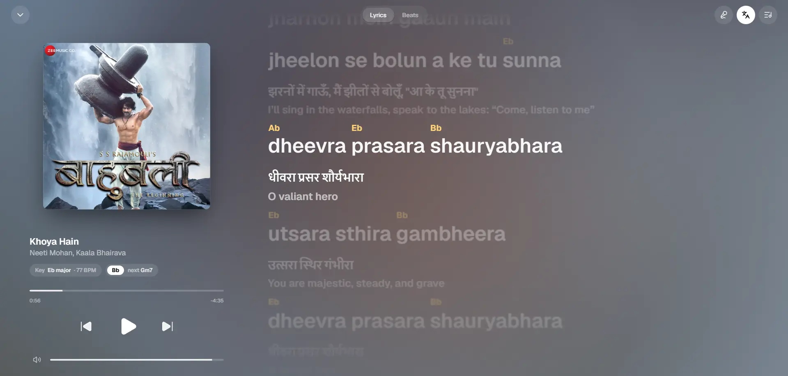
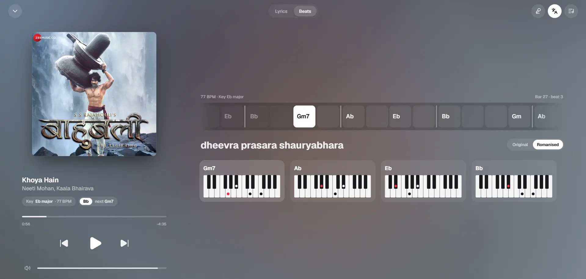
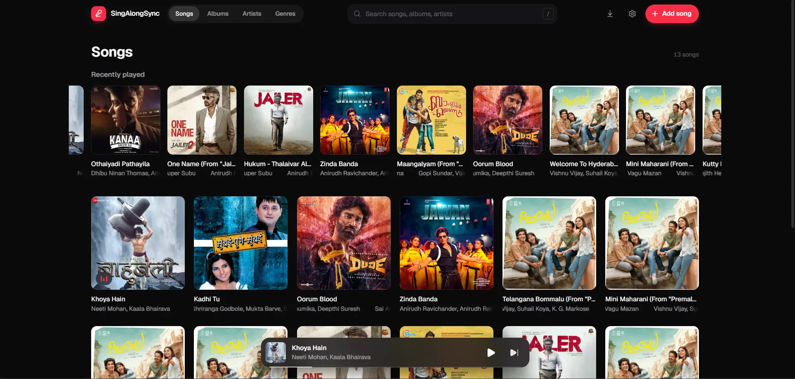
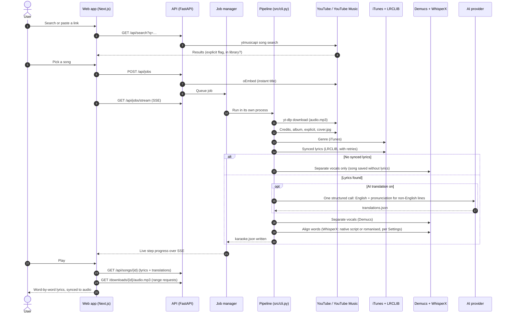

# 🎤 SingAlongSync

**Apple Music Sing-style, word-by-word synced lyrics for any song on YouTube Music.** Paste a link, get karaoke.



<table>
  <tr>
    <td></td>
    <td></td>
  </tr>
</table>

<video src="https://github.com/user-attachments/assets/1d4e6b07-aa70-422a-8471-a0f9f89d1bb9" controls width="100%"></video>

_[Watch the web app demo](https://github.com/user-attachments/assets/1d4e6b07-aa70-422a-8471-a0f9f89d1bb9) · [Watch adding a song](https://github.com/user-attachments/assets/41a27458-c6f1-421a-a347-4c5be5f71d45) · [Watch the CLI demo](https://github.com/user-attachments/assets/317f310f-c52e-434c-95ad-9657a1131856)_

It downloads the audio, separates the vocals with **Demucs**, fetches synced lyrics from **LRCLIB** and times every word with **WhisperX**. Use it from the terminal, or through the included Apple Music-style web app.

> [!IMPORTANT]
> **SingAlongSync is not a piracy tool, and we don't endorse piracy.**
>
> It is a personal, local karaoke and practice tool. Songs are processed on your own machine and stay there: SingAlongSync has no sharing, uploading or export feature, and none will be added.
>
> Only process music you have the right to use, and follow YouTube's Terms of Service and the copyright laws where you live. Don't redistribute downloaded audio, separated stems or lyrics. Lyrics come from LRCLIB's community database and remain the property of their rights holders.
>
> SingAlongSync is not affiliated with or endorsed by YouTube, Google or Apple. "Apple Music" is mentioned only to describe the lyrics style.

## ✨ Features

- **Word-by-word lyrics** timed to the millisecond, in English, Hindi, Telugu, Malayalam and more
- **Karaoke mode** (instrumental with optional guide vocals) and **vocals only**
- **Key, BPM and chords** detected per song, with chords above the lyrics and a beat view with piano diagrams
- **Translations and pronunciation** for non-English lyrics, using your own AI provider key
- **Library** of songs, albums, artists and genres, with covers and credits from YouTube Music
- **Add songs** by search, link, or a whole album or playlist, with live progress
- **Fix lyrics** by picking another LRCLIB match, pasting LRC, or nudging the timing

## 🚀 Quick Start

You need Python ≥ 3.11 with [uv](https://docs.astral.sh/uv/), [FFmpeg](https://ffmpeg.org/), [Bun](https://bun.sh/), and Node.js, Deno or Bun for YouTube's JS challenge. An NVIDIA GPU is strongly recommended; Demucs and WhisperX fall back to CPU, slowly.

```bash
# Backend: API on http://127.0.0.1:8000
cd server
uv sync
uv run app.py

# Web app, in a second terminal: http://localhost:3000
cd web
bun install
bun run dev
```

Or process a song from the terminal, without the web app:

```bash
cd server
uv run src/cli.py "https://music.youtube.com/watch?v=eZCWyFNV_ZM"
```

Output goes to `server/downloads/<video_id>/`, which the web app reads too. Steps that already have output are skipped, so a failed run resumes where it stopped.

## 📖 Usage

<details>
<summary><b>Watch adding a song</b> (search, pick, live progress)</summary>

<video src="https://github.com/user-attachments/assets/41a27458-c6f1-421a-a347-4c5be5f71d45" controls width="100%"></video>

</details>

- **Add a song:** click **Add song**, then search YouTube Music or paste a link. An album or playlist link lets you pick the tracks to queue.
- **Play:** `Space` play/pause, `←`/`→` seek 5 s, `M` mute, `K` karaoke mode, `[`/`]` shift lyrics 0.1 s, `/` search, `Esc` close the player.
- **Player header:** the microphone holds karaoke mode, guide vocals and vocals only. The language button holds translation, pronunciation, chords, the key readout and lyrics timing. The list button shows what plays next.
- **Fix or add lyrics:** **Find lyrics** (or **Lyrics options > Find different lyrics**) searches LRCLIB, or takes pasted LRC text or an `.lrc` file. The song is re-aligned in about a minute.
- **AI translation:** in **Settings**, pick OpenAI, Google, Anthropic, Groq, xAI or OpenRouter, paste an API key and choose a model. New songs get translated automatically; **Translate all** handles songs already in your library. The key is stored in `server/settings.json` (gitignored) and never sent back to the browser.

**"Sign in to confirm you're not a bot"?** YouTube does this after many downloads from one IP. In **Settings > YouTube access**, pick a browser you're signed in to YouTube with (Firefox is most reliable on Windows; Chrome and Edge lock their cookies while open) or point to an exported `cookies.txt`, then press **Test**.

<details>
<summary><b>Configuration (<code>server/.env</code>)</b></summary>

```bash
HF_TOKEN=...                                # Hugging Face token, avoids rate limits on alignment models
WEB_ORIGINS=http://localhost:3000           # Origins allowed to call the API (comma-separated)
YTDLP_COOKIES_FROM_BROWSER=firefox          # Or YTDLP_COOKIES_FILE=C:\path\to\cookies.txt
HF_HUB_DISABLE_SYMLINKS_WARNING=1           # Silences a harmless Windows warning
```

The web app proxies `/api` and `/downloads` to the backend, so a single tunnel on port 3000 serves everything. To call an API somewhere else directly, set `NEXT_PUBLIC_API_URL` and add the web app's origin to `WEB_ORIGINS`.

</details>

## ⚙️ How It Works

1. **Download:** `yt-dlp` fetches a 320 kbps `audio.mp3`, retrying up to 3 times. YouTube Music adds credits, album, year, explicit flag and a square cover; iTunes adds the genre.
2. **Lyrics:** LRCLIB synced lyrics, matched by title, artist and duration. Songs without lyrics are still saved and playable, and lyrics can be added later.
3. **Translate** *(optional)*: one structured AI call returns English and Latin-letter pronunciation for non-English lines. A failure never fails the song.
4. **Separate:** Demucs (`htdemucs`) splits vocals from the instrumental, plus MP3 copies for karaoke mode.
5. **Align:** WhisperX times every word, with a model picked from the lyrics' script. Scripts without their own model (Punjabi, Tamil, Kannada, Bengali, Gujarati, Odia) are romanised and aligned with the English model; **Settings > Lyrics alignment** can force either way. The player always shows the original words.
6. **Analyse** *(background)*: key with **S-KEY**, chords with **BTC** using **ChordMini**'s weights, and beats, bars and BPM with **Beat This!**.

<details>
<summary><b>Sequence diagram</b></summary>



The CLI runs the same pipeline (steps 11–19) directly in your terminal.

</details>

<details>
<summary><b>Output files and schemas</b></summary>

Every processed song gets its own folder at `server/downloads/<video_id>/`:

```
downloads/<video_id>/
├── audio.mp3          # High-quality 320kbps track
├── audio.webp         # YouTube video thumbnail (16:9)
├── cover.jpg          # Square album cover from YouTube Music (preferred artwork)
├── metadata.json      # Title, artists, album, genre, year, explicit flag…
├── synced.lrc         # Line-synced lyrics from LRCLIB
├── vocals.wav         # Demucs vocal stem
├── instrumental.wav   # Demucs instrumental stem
├── vocals.mp3         # Compressed stems streamed by karaoke mode
├── instrumental.mp3
├── karaoke.json       # Word-level timings
├── translations.json  # English for non-English lines (only with AI translation)
├── analysis.json      # Detected key, chords, beats and BPM
├── status.json        # Pipeline stage and progress
└── job.log            # Full output of jobs started from the web app
```

**`karaoke.json`**: an array of lines, each with its words and their start/end times in seconds. Use it to power color-sweeping lyrics in your own player, video editor or karaoke engine.

```json
[
  {
    "line": "La da, la da da, la la la",
    "start": 3.721,
    "end": 7.119,
    "words": [
      { "word": "La", "start": 3.721, "end": 3.983 },
      { "word": "da,", "start": 4.204, "end": 4.626 },
      { "word": "la", "start": 4.666, "end": 4.908 }
    ]
  }
]
```

**`metadata.json`**: from `yt-dlp`, enriched with YouTube Music and iTunes. `genre`, `year` and `explicit` are `null` when unknown.

```json
{
  "videoId": "W2a8Ng1qM8Q",
  "title": "Your Love",
  "artist": "The Outfield",
  "artists": ["The Outfield"],
  "artistIds": { "The Outfield": "UC5TJtEuZGgv1Ci7cGF8gfCw" },
  "album": "Play Deep",
  "albumId": "MPREb_xwBJwx1f3xG",
  "year": "1985",
  "explicit": false,
  "genre": "Rock",
  "duration": 216,
  "thumbnail": "https://i.ytimg.com/vi_webp/W2a8Ng1qM8Q/maxresdefault.webp",
  "enriched": 2
}
```

**`translations.json`**: English keyed by the line's index in `karaoke.json`. Lines already in English are left out, so an empty `lines` object means the song is entirely English.

```json
{
  "provider": "openai",
  "model": "gpt-…",
  "createdAt": 1791812669.2,
  "version": 2,
  "lines": {
    "0": "I would give my life for you, I would give my life",
    "3": "O beloved, O my beloved"
  },
  "romanized": {
    "0": "Main vaari jaavan, main vaari jaavan"
  }
}
```

</details>

<details>
<summary><b>Project structure</b></summary>

```
SingAlongSync/
├── server/                 # Python backend (uv project)
│   ├── app.py              # Entry point: starts the API on 127.0.0.1:8000
│   ├── src/
│   │   ├── cli.py          # CLI entry point
│   │   ├── pipeline.py     # KaraokePipeline: download, lyrics, translate, separate, align
│   │   ├── api.py          # FastAPI routes
│   │   ├── jobs.py         # Background download jobs (one at a time, live progress)
│   │   ├── analysis/       # Key, chord and beat detection (vendored models)
│   │   ├── youtube.py      # yt-dlp download, oEmbed quick metadata
│   │   ├── ytmusic.py      # YouTube Music search, credits, covers, artist avatars
│   │   ├── enrich.py       # Metadata enrichment + background backfill
│   │   ├── lyrics.py       # LRCLIB search and LRC parsing
│   │   ├── lang.py         # Script detection and WhisperX align codes
│   │   ├── translate.py    # AI translation (pydantic-ai) and provider model lists
│   │   ├── settings.py     # App settings (server/settings.json)
│   │   └── library.py, status.py, stems.py, config.py, …
│   └── downloads/          # One folder per processed song
└── web/                    # Next.js + Tailwind web app (bun)
    ├── app/                # Routes: /, /albums, /artists, /genres, their detail pages, /settings
    ├── components/         # library/, player/, settings/, shell/, ui/
    └── lib/                # API client, player engine, stores
```

</details>

## 🙏 Credits

### Key, chord and beat detection

These models run in `server/src/analysis/`. Their model code is vendored (each folder keeps the original MIT `LICENSE` and a header naming the source commit); pretrained weights are downloaded from the authors' repositories on first use, pinned and checksum-verified, and are not redistributed here.

| What | Project | Authors & paper | License |
|---|---|---|---|
| Musical key | [**S-KEY**](https://github.com/deezer/skey) (Deezer Research) | Yuexuan Kong, Gabriel Meseguer-Brocal, Vincent Lostanlen, Mathieu Lagrange, Romain Hennequin. *S-KEY: Self-supervised Learning of Major and Minor Keys from Audio.* ICASSP 2025. [doi:10.1109/ICASSP49660.2025.10890222](https://doi.org/10.1109/ICASSP49660.2025.10890222) | MIT (code); weights from the authors' repo |
| Chords (model) | [**BTC**](https://github.com/jayg996/BTC-ISMIR19), Bi-directional Transformer for Chord Recognition | Jonggwon Park, Kyoyun Choi, Sungwook Jeon, Dokyun Kim, Jonghun Park. *A Bi-directional Transformer for Musical Chord Recognition.* ISMIR 2019. [arXiv:1907.02698](https://arxiv.org/abs/1907.02698) | MIT |
| Chords (improved weights & implementation) | [**ChordMini**](https://github.com/ptnghia-j/ChordMini) | Nghia Phan, Rong Jin, Gang Liu, Xiao Dong. *Enhancing Automatic Chord Recognition via Pseudo-Labeling and Knowledge Distillation.* 2026. [arXiv:2602.19778](https://arxiv.org/abs/2602.19778) | MIT |
| Beats & bars | [**Beat This!**](https://github.com/CPJKU/beat_this) (CPJKU, JKU Linz) | Francesco Foscarin, Jan Schlüter, Gerhard Widmer. *Beat this! Accurate beat tracking without DBN postprocessing.* ISMIR 2024. | MIT |

The key decision rule (using detected chords to settle major vs minor) and the chord display are SingAlongSync's own; any mistakes in them are ours, not the models' authors'.

### Audio, lyrics and metadata

- [**WhisperX**](https://github.com/m-bain/whisperX): word-level forced alignment of lyrics to vocals
- [**Demucs**](https://github.com/facebookresearch/demucs) (Meta AI): vocal / instrumental source separation (`htdemucs`)
- [**yt-dlp**](https://github.com/yt-dlp/yt-dlp): audio download, with [yt-dlp-ejs](https://github.com/yt-dlp/ejs) for YouTube's JS challenge
- [**ytmusicapi**](https://github.com/sigma67/ytmusicapi): YouTube Music search, credits, albums and artist avatars
- [**LRCLIB**](https://lrclib.net/): community database of time-synced lyrics
- [**iTunes Search API**](https://performance-partners.apple.com/search-api) (Apple): song genres
- [**indic-transliteration**](https://github.com/indic-transliteration/indic_transliteration_py): rule-based romanisation for alignment
- [**pydantic-ai**](https://github.com/pydantic/pydantic-ai): structured-output AI translation across providers
- [**librosa**](https://github.com/librosa/librosa) and [**nnAudio**](https://github.com/KinWaiCheuk/nnAudio): audio features for the analysis models

### Web app

- [**Next.js**](https://nextjs.org/), [**Tailwind CSS**](https://tailwindcss.com/), [**Lucide**](https://lucide.dev/) icons, [**Geist**](https://vercel.com/font) font
- AI provider logos from [**theSVG**](https://thesvg.org/); they are trademarks of their respective owners

## 💻 Tested Hardware

NVIDIA GeForce RTX 4050 Laptop GPU (6 GB), driver `610.62`, PyTorch `2.7.1+cu126` (installed from the CUDA 12.6 wheel index).
